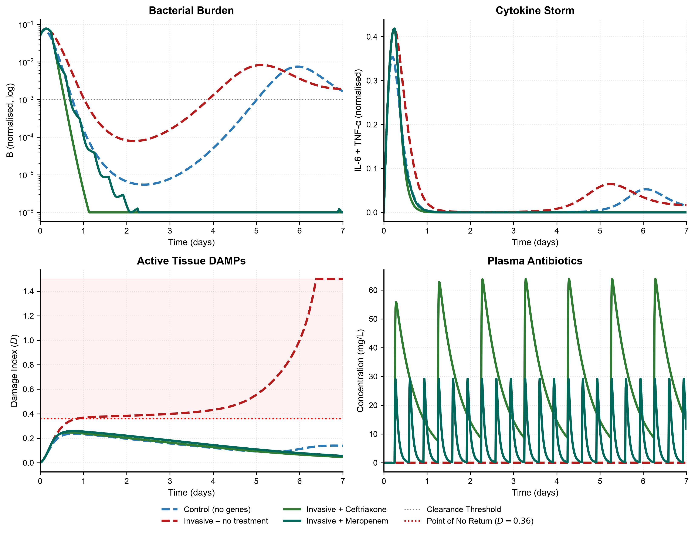
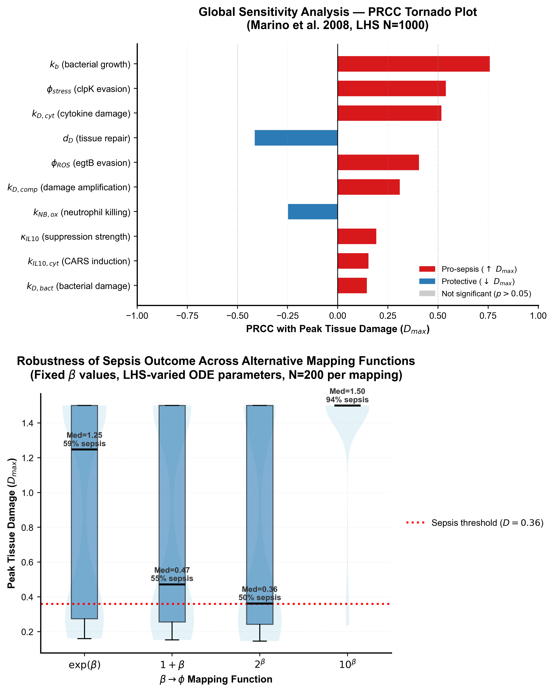
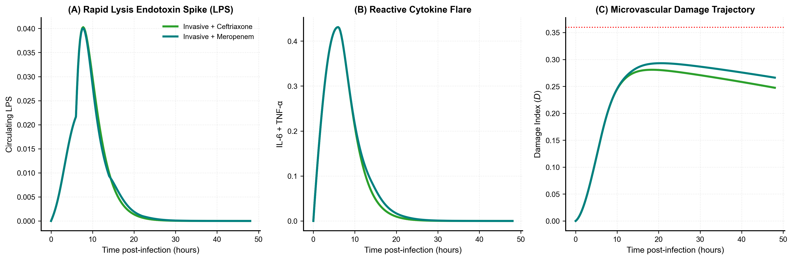
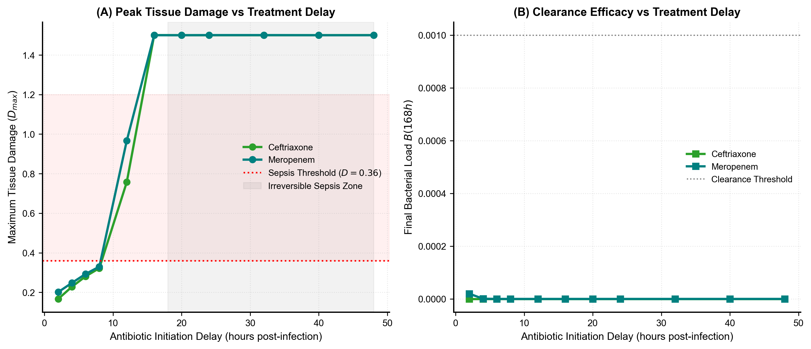

# Translating Bacterial Population Genomics into Infection Dynamics: A Mechanistic ODE Model of Sepsis

[](https://www.python.org/)
[](LICENSE)
[]()
[]()

> **A Systems Biology Framework linking *Klebsiella pneumoniae* Pangenome-Wide Association (mGWAS) Effect Sizes to Longitudinal Sepsis Pathophysiology, Endotoxin Release, and Antibiotic PK/PD Dynamics.**

---

## 📌 Overview

The clinical trajectory of Gram-negative sepsis is governed by nonlinear interactions between bacterial virulence and the host immune response. While microbial genome-wide association studies (mGWAS) using linear mixed models (such as `pyseer`) identify accessory genes associated with bacteremia, static effect sizes ($\beta$) cannot capture temporal infection kinetics, cytokine storms, or therapeutic timing.

This repository provides a mathematical framework that bridges statistical genomics and clinical pathophysiology by translating statistical log-odds effect sizes into mechanistic rate multipliers within a multi-compartment **Ordinary Differential Equation (ODE)** systems biology model.

```
┌─────────────────────────────────┐       φ = exp(β)       ┌───────────────────────────────────────┐
│   Bacterial Population Genomics │ ─────────────────────> │     Mechanistic ODE Sepsis Model      │
│   • pyseer mGWAS                │   Rate Multipliers     │   • 9-to-10 State Compartments        │
│   • clpK/clpB operon (β = 0.434)│                        │   • Neutrophils, Macrophages, DAMPs   │
│   • egtB pathway     (β = 0.394)│                        │   • Cytokines (IL-6, TNF-α, IL-10)   │
│   • bla_1 / IS6      (β = 0.350)│                        │   • LPS Kinetics & Antibiotic PK/PD   │
└─────────────────────────────────┘                        └───────────────────────────────────────┘
```

---

## 🔬 Key Scientific Findings

1. **Epistatic Virulence Synergy & Bifurcation:**  
   Single virulence genes produce self-limiting inflammation, but their co-occurrence (*egtB* + *clpK/clpB*) drives host tissue injury across an irreversible bifurcation threshold ($D_{\text{max}} > 0.36$) into multi-organ failure.
2. **Therapeutic "Golden Window" (10 Hours):**  
   Titrating antibiotic administration delays reveals a strict 10-hour golden window. Administration at 6 hours post-inoculation successfully curbs tissue damage ($D \approx 0.28-0.29$ vs. $1.50$ untreated); beyond 10 hours, bacteriological clearance fails to prevent fatal septic collapse.
3. **Endotoxin (LPS) Bacteriolytic Surge:**  
   Simulating bactericidal antibiotic action reveals that rapid bacteriolysis by cell-wall active agents (e.g., meropenem) triggers a transient **+74% surge in free endotoxin (LPS)** ($0.040$ at 7.5 h), explaining clinical post-antibiotic inflammatory flares.
4. **Global Topological Robustness (LHS-PRCC, $N=1,000$):**  
   Global sensitivity analysis following the Marino et al. (2008) framework proves that threshold-crossing behavior is robust across alternative mapping formulations ($\phi = 1+\beta$, $2^\beta$, $10^\beta$) and not an artifact of the exponential mapping function.

---

## 📊 Publication Figures & Simulation Visualizations

### Clinical Trajectories & Trajectory Bifurcation
<p align="center">
  
</p>

### Global Sensitivity Analysis & Alternative β-to-φ Mappings
<p align="center">
  
</p>

### Endotoxin (LPS) Release & Bacteriolysis Flare
<p align="center">
  
</p>

### Antibiotic "Golden Window" Delay Analysis
<p align="center">
  
</p>

---

## 📐 Mathematical Framework & State Variables

The model consists of 9 to 10 coupled ordinary differential equations tracking key biological compartments:

| Variable | Description | Biological Role |
| :--- | :--- | :--- |
| **$B$** | Bacterial burden | Pathogen load in tissue/bloodstream |
| **$N$** | Activated Neutrophils | First-line cellular immunity and phagocytosis |
| **$M$** | Activated Macrophages | Antigen presentation and cytokine amplification |
| **$\text{IL-6}$** | Interleukin-6 | Acute phase pro-inflammatory signaling |
| **$\text{TNF-}\alpha$** | Tumor Necrosis Factor $\alpha$ | Endothelial activation and immune recruitment |
| **$\text{IL-10}$** | Interleukin-10 | Anti-inflammatory regulatory brake via $S_{\text{IL-10}}$ |
| **$D$** | Tissue Damage Index | Quantifies microvascular injury and DAMP burden |
| **$A_{\text{depot}}$** | Antibiotic (Depot) | One-compartment intramuscular/subcutaneous depot |
| **$A_{\text{plasma}}$** | Antibiotic (Plasma) | Systemic bioavailable drug concentration |
| **$LPS$** | Lipopolysaccharide | Free circulating endotoxin from lysis and shedding |

### Genomic Rate Multipliers ($\phi$)

Statistical coefficients from `pyseer` mGWAS are translated via:
$$\phi = \exp(\beta)$$

- **$\phi_{\text{stress}} = \exp(0.434) = 1.543$** (*clpK/clpB* operon): Chaperone-mediated resistance to proteotoxic and thermal stress, attenuating clearance.
- **$\phi_{\text{ROS}} = \exp(0.394) = 1.483$** (*egtB* ergothioneine pathway): Scavenges reactive oxygen species, blunting neutrophil oxidative burst killing.
- **$\phi_{\beta\text{-lactam}} = \exp(0.350) = 1.419$** (*bla_1* / IS6 elements): Beta-lactamase mediated blunting of drug-induced bacteriolytic clearance.

---

## 📁 Repository Structure

```text
├── pyseer_ode_model.py                     # Core 9-compartment ODE sepsis model & 4 clinical scenarios
├── pyseer_ode_lps_extended.py              # Extended 10-compartment model (LPS kinetics, Golden Window)
├── sensitivity_analysis.py                 # Global Sensitivity Analysis (LHS-PRCC, N=1,000)
├── final_5hits.fasta                       # FASTA sequences of mGWAS-identified virulence loci
│
├── build_calibrated_4k_manuscript.py       # Automated generator for calibrated 4k-word OMICS manuscript
├── build_calibrated_manuscript.py          # Supplementary manuscript build scripts
├── generate_7k_manuscript.py               # Comprehensive 7k-word revised manuscript generator
├── OMICS_Manuscript_4000w.docx             # Ready-to-submit 4,000-word calibrated Word manuscript
├── Translating Bacterial Population...docx # Full comprehensive revised manuscript Word document
│
├── Fig1_Clinical_Summary.png               # Clinical trajectories & bifurcation comparison
├── Fig1_Sensitivity_and_Mapping_...png     # Multi-panel composite validation figure
├── Fig5_PRCC_Tornado.png                   # PRCC tornado sensitivity ranking
├── Fig6_Phi_vs_Dmax_Scatter.png            # Virulence multiplier vs. peak damage scatter
├── Fig7_Mapping_Comparison.png             # Alternative β-to-φ mapping comparison
├── Fig_LPS_1_Clinical_Trajectories.png     # 10-compartment LPS trajectory simulation
├── Fig_LPS_2_Endotoxin_Lysis_Comparison.png# Bacteriolysis-induced endotoxin comparison
├── Fig_LPS_3_Inoculum_Dose_Response.png    # Pathogen inoculum threshold titration
├── Fig_LPS_4_TimeToTreatment_Window.png    # 10-hour golden window antibiotic delay analysis
├── Fig_LPS_5_Full_State_Variables.png      # Multi-panel state variable trajectories
│
├── pyseer_ode_mathematical_explanation.md  # Complete equations, parameters, and derivations
├── sensitivity_analysis_methods_results.md # LHS-PRCC protocol and statistical results
├── LHS_PRCC_Explanation.md                 # Parameter sampling and rank correlation breakdown
├── Discussion.md                           # Comprehensive discussion of biological implications
├── References.md                           # Bibliography and literature citations
│
├── requirements.txt                        # Python dependencies
├── LICENSE                                 # MIT License
└── README.md                               # Project documentation
```

---

## 🚀 Quick Start & Installation

### 1. Clone the repository
```bash
git clone https://github.com/gauthamgl/Gautham-s_ode_model.git
cd Gautham-s_ode_model
```

### 2. Create a virtual environment and install dependencies
```bash
python3 -m venv venv
source venv/bin/activate
pip install -r requirements.txt
```

---

## 💻 Running the Simulations

### Core 9-Compartment ODE Model
Simulates the non-invasive control, untreated invasive infection, and antibiotic-treated scenarios:
```bash
python3 pyseer_ode_model.py
```

### Extended 10-Compartment LPS & Golden Window Model
Evaluates endotoxin release kinetics, inoculum dose-response, and antibiotic time-to-treatment delay:
```bash
python3 pyseer_ode_lps_extended.py
```

### Global Sensitivity Analysis (LHS-PRCC)
Performs Latin Hypercube Sampling across 1,000 parameter iterations and computes Partial Rank Correlation Coefficients:
```bash
python3 sensitivity_analysis.py
```

### Generate Calibrated Manuscript Document
Builds the formatted Microsoft Word (`.docx`) manuscript adhering to target journal guidelines:
```bash
python3 build_calibrated_4k_manuscript.py
```

---

## 👥 Authors & Affiliations

- **Gautham G L** — Department of Biotechnology, National Institute of Technology, Rourkela, India.
- **Dhruti Reddy P** — Department of Biotechnology, National Institute of Technology, Rourkela, India.
- **S Apurva Ananya** — Department of Biotechnology, National Institute of Technology, Rourkela, India.
- **Dr. Sasmita Sabat\*** *(Corresponding Author)* — Department of Biotechnology, National Institute of Technology, Rourkela, India. (Email: `sasmita.sabat@nitrkl.ac.in`)

---

## 📜 License

This project is licensed under the **MIT License** — see the [LICENSE](LICENSE) file for details.
